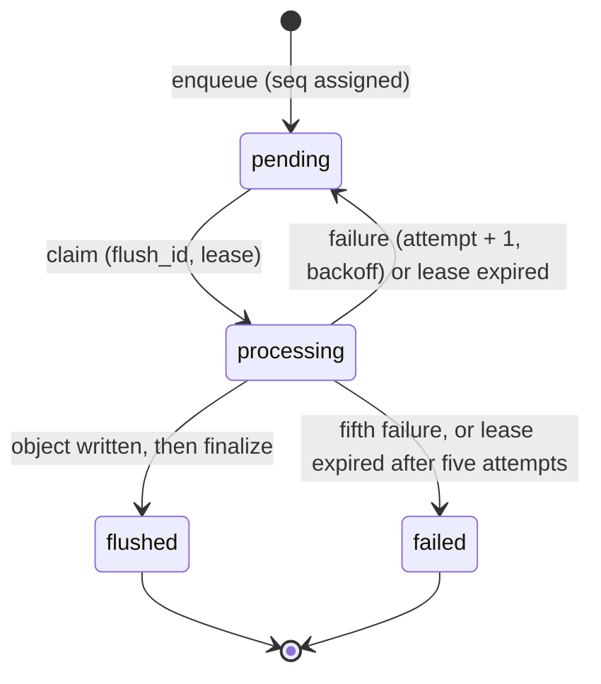

# Design

This document describes how the service is built and why: the components and
their boundaries, the data model, the concurrency model, the failure model,
and how each guarantee is tested.

## 1. Goals

- **Correct under concurrency.** Two requests racing for the same agent, or
  several workers racing for the same events, must produce exactly one winner
  and leave no partial state behind.
- **Durable, ordered, at-least-once event export, with idempotent output.**
  Every accepted event is eventually written to the object store, in global
  order, and retries never produce a second copy of a batch.
- **Survive crashes at any point.** A process killed between any two steps is
  recovered by another process without operator action.
- **Verifiable backups.** A restore either reproduces a backup exactly or
  writes nothing.
- **Runs on one machine.** No external services; `docker compose up` or two
  Python processes.

Non-goals: multi-host scale-out, end-user authentication, and exactly-once
delivery to systems outside this service.

## 2. Components

```text
             HTTP                                    poll
 Client ───────────► API process ◄──┐     ┌──► Worker process(es)
                        │           │     │          │
                        ▼           │     │          ▼
                  ┌──────────── Repository port ──────────┐
                  │   SqliteRepository  (WAL, one file)   │
                  └───────────────────────────────────────┘
                                         │
                  ┌──────────── ObjectStore port ─────────┐
                  │   LocalObjectStore  (directory tree)  │
                  │   FaultyObjectStore (optional wrapper) │
                  └───────────────────────────────────────┘
```

| Component | Responsibility |
| --- | --- |
| API (`app/main.py`) | Validates requests, calls one repository method per state change, maps errors to HTTP |
| Worker (`app/buffer_worker.py`) | Polls the buffer, flushes batches when the threshold is reached |
| Flush, backup (`app/buffer_service.py`) | CSV encoding, flush protocol, backup manifest |
| Restore (`app/restore_backup.py`) | Offline CLI: verify a backup, optionally apply it |
| `Repository` port (`app/ports.py`) | Every state change as one transactional method with stable error codes |
| `ObjectStore` port | Conditional create (`put` returns `False` if the key exists) and read |
| `Clock` | Injected time source; tests use a manual clock |
| `app/config.py` | Reads the environment and is the only place concrete adapters are chosen |

Application code depends only on the ports. A different database or object
store is a new adapter that passes the same contract tests (section 9).

## 3. Data model

All identifiers are UUIDs stored as text. JSON is stored as text and checked
with `json_valid`. Timestamps are fixed-width ISO 8601 UTC strings produced by
the injected clock, so they sort correctly as strings.

| Table | Purpose | Key constraints |
| --- | --- | --- |
| `agent_registry` | Agent configuration | `status ∈ {active, disabled}`; `disabled_at` set iff disabled |
| `agent_skills` | Skills per agent | PK `(aid, skill)`; skill not blank |
| `tasks` | Work items | `status ∈ {pending, running, completed, failed}`; `completed_at` set iff terminal |
| `agent_runtime_current` | One row per agent, the lock target for claiming | `task_id` set iff `state = running` |
| `agent_runtime_log` | Append-only history of runtime states | — |
| `buffer_events` | Durable event queue | see section 5 |
| `schema_migrations` | Applied migration versions | — |

Migrations are plain SQL files applied in order, each in its own
`BEGIN IMMEDIATE` transaction together with its `schema_migrations` row, so two
processes starting at once cannot both apply a version and a failed migration
leaves no trace.

## 4. Agents and tasks

### Task claiming

`POST /v1/agents/{aid}/tasks` runs one transaction:

1. Reject a missing agent (`404 NOT_FOUND`) or a disabled one (`409 AGENT_DISABLED`).
2. Insert the task as `pending`.
3. `UPDATE agent_runtime_current SET state = 'running', task_id = … WHERE aid = ? AND state = 'idle'`.
4. If that update changed no row, the agent is busy: raise `409 AGENT_BUSY`
   and roll back, which also removes the task inserted in step 2.
5. Append `running` to the runtime log.

The conditional update in step 3 is the claim. Because the whole method runs
under the write lock, concurrent callers are serialized and exactly one of
them sees `state = 'idle'`.

### Results and agent mutation

- A result can be recorded once. The update only matches `pending` or
  `running` tasks; a second call gets `409 TASK_ALREADY_TERMINAL`. Recording a
  result returns the agent to `idle`.
- A busy agent cannot be modified or disabled (`409 AGENT_BUSY`). Disabling is
  idempotent; modifying a disabled agent returns `409 AGENT_DISABLED`.

### Runtime state reports

`POST /v1/agents/{aid}/states` appends to the log and updates the current row,
with these rules checked in order:

| Rule | Error |
| --- | --- |
| `state ∈ {idle, running, offline, disabled}` | `422 INVALID_STATE` |
| Agent exists | `404 NOT_FOUND` |
| `disabled` only for a disabled agent | `409 AGENT_NOT_DISABLED` |
| `running` requires a task id | `422 TASK_REQUIRED` |
| Other states must not carry a task id | `422 TASK_NOT_ALLOWED` |
| The task belongs to the agent and is not terminal | `404 TASK_NOT_FOUND` |
| The agent is not attached to a different task | `409 AGENT_BUSY` |

`GET /v1/agents/{aid}/state` returns the latest log row, ordered by timestamp
and then by insertion order, so two reports in the same clock tick still
resolve deterministically.

## 5. Event buffer

### Lifecycle



### Flush protocol

```text
worker                                repository                     object store
  │ recover_expired_leases ─────────────►│
  │ claim_buffer_batch ─────────────────►│  oldest eligible events, one flush_id
  │◄──────────────── events (seq order) ─│
  │ key = prefix/buffer/YYYY-MM-DD/flush-<claim time>-<flush_id>.csv
  │ put(key, csv) ───────────────────────────────────────────────────►│ create if absent
  │ mark_buffer_flushed(flush_id, key) ─►│  processing → flushed
  │                                      │
  │ on any error: mark_buffer_retry ────►│  attempt + 1, available_at = now + backoff
```

Design decisions:

- **Global order.** `seq` is an `AUTOINCREMENT` key. Claims run under the write
  lock and always take the lowest eligible `seq` values, so concurrent claims
  receive disjoint, non-interleaving ranges. With a single writer, `seq` order
  is also commit order: a lower `seq` can never become visible after a higher
  one has been claimed.
- **Threshold.** The worker flushes only when at least `BUFFER_FLUSH_THRESHOLD`
  events are eligible; the manual endpoint forces a flush of any size.
- **Stable batch identity.** A batch keeps its `flush_id` and claim timestamp
  across retries and lease recovery. When incomplete batches exist, a claim
  resumes the oldest one before starting a new batch. The object key is
  derived only from these two values.
- **Upload, then finalize.** Events are marked `flushed` only after the object
  exists. If the process dies or the database update fails after the upload,
  the retry recomputes the same key, `put` returns `False` because the object
  already exists, and only the database update is repeated. The output is
  idempotent even though the delivery attempt is at-least-once.
- **Retry state lives in the database.** `attempt_count`, `available_at` and
  `last_error` (truncated to 2,000 characters) are stored per event, so any
  worker can continue a retry. The delay is 1, 2, 4, 8… seconds, capped at 300.
- **Poison batches stop.** The fifth failure marks the batch `failed`; it is
  excluded from claims and newer events continue to flow. Failed rows stay in
  the table for inspection.
- **Leases.** A claim holds the batch for `BUFFER_FLUSH_LEASE_SECONDS`. Every
  claim first returns expired batches to `pending` (or to `failed` if they
  already used five attempts). A worker therefore needs no shutdown protocol.

CSV columns: `seq,event_id,event_type,event_timestamp,payload_json,created_at`,
rows in ascending `seq`; `payload_json` is compact JSON.

## 6. Object store

The `ObjectStore` contract has two properties, and `LocalObjectStore`
implements both on a plain filesystem:

- **Conditional create.** Writing to an existing key returns `False` and leaves
  the existing object untouched.
- **Atomic visibility.** The body is written and fsynced to a temporary file in
  the target directory, then published with `os.link`, which fails if the
  target exists. Readers see either nothing or the complete object; when
  twenty writers race for one key, exactly one wins.

Keys must match `[A-Za-z0-9._-]+(/[A-Za-z0-9._-]+)*` and may not contain `.` or
`..` segments. Keys are validated as raw strings, before any path
normalization: otherwise `a//b`, `a/./b` or `C:/b` could resolve to another
key's file, and two keys sharing one file would break conditional create.

## 7. Backup and restore

```text
<prefix>/backups/YYYY-MM-DD/<backup_id>/{agent_registry,agent_skills,tasks,agent_runtime_log}.csv
<prefix>/backups/YYYY-MM-DD/<backup_id>/manifest.json
```

- **Consistent snapshot.** All four tables are read in one read transaction;
  under WAL every query sees the same snapshot.
- **Manifest last.** The manifest records each object's key, row count, byte
  size and SHA-256, and is written only after every data object. A manifest
  with `status: completed` therefore implies complete data.
- **Verify before write.** Restore reads every object and checks the manifest's
  table set, the checksums and the row counts before touching the database.
  `--apply` is required to write.
- **All or nothing.** The upserts for all tables and the rebuilt
  `agent_runtime_current` rows run in one transaction.
- **Derived state is rebuilt, not copied.** `agent_runtime_current` is computed
  from the latest log row per agent, and keeps a task id only for `running`.
  Completing a task logs `idle` together with the finished task id; copying
  that row verbatim would violate the table's state/task check.
- **Untrusted input.** CSV header names are checked against the table schema
  before they appear in SQL.

The buffer table is not part of database backups; flushed events are already
archived as CSV objects.

## 8. Concurrency model

- Every write transaction begins with `BEGIN IMMEDIATE`, taking SQLite's single
  write lock up front. This serializes writers across threads and processes;
  waiting writers block for up to 10 seconds (busy timeout).
- Readers use WAL snapshots and never block or get blocked by writers.
- Each write transaction reads the clock once, after acquiring the lock, so
  commit order and timestamp order agree.
- Each repository call opens its own connection and runs in a worker thread,
  keeping the async API responsive.

The trade-off is deliberate: one global write lock instead of per-agent or
per-row locks. It removes whole classes of races (claim ordering, lost
updates) at the cost of write throughput, which is ample for one host.

## 9. Failure model

| Failure | Behavior | Proven by |
| --- | --- | --- |
| Concurrent task creation for one agent | One succeeds; the rest get `AGENT_BUSY` and leave no rows | `test_concurrent_task_creation_claims_the_agent_exactly_once` |
| Concurrent buffer claims | Disjoint batches in `seq` order | `test_concurrent_claims_take_disjoint_batches_in_global_order` |
| Object write fails | Retry after backoff, same key | `test_store_failure_schedules_a_retry_with_backoff` |
| Object written, then the database update fails | Retry finds the object, finishes the update, no duplicate | `test_retry_after_successful_upload_reuses_the_key_without_duplicating[finalization]` |
| Object written, acknowledgement lost | Same | `…[lost_ack]` |
| Worker killed after claiming | Another worker resumes the same batch after the lease expires | `test_worker_killed_mid_flush_is_recovered_by_another_process` |
| A batch fails five times | `failed`; newer events still flush | `test_poison_batch_fails_after_five_attempts_and_newer_events_still_flush` |
| Corrupted backup object | Restore aborts before writing | `test_restore_rejects_a_corrupted_object_before_any_write` |
| Restore fails part-way | Nothing is written | `test_restore_is_all_or_nothing` |

### Fault injection

`FaultyObjectStore` wraps any object store and is enabled through environment
variables, in tests or in the running compose stack:

| Variable | Fault |
| --- | --- |
| `FAULT_PUT_FAILURES=N` | The first N writes fail before writing |
| `FAULT_PUT_LOST_ACKS=N` | The next N writes succeed, but the caller receives an error |
| `FAULT_PUT_FAILURE_RATE=p` | Each write fails before writing with probability p |
| `FAULT_SEED` | Seed for the random faults, so a run can be reproduced |
| `FAULT_PUT_LATENCY_MS` | Added latency per write |

## 10. API contract

Errors share one envelope:

```json
{ "success": false, "error_code": "AGENT_BUSY", "message": "AGENT_BUSY" }
```

| Error code | HTTP |
| --- | ---: |
| `NOT_FOUND`, `TASK_NOT_FOUND` | 404 |
| `AGENT_DISABLED`, `AGENT_BUSY`, `TASK_ALREADY_TERMINAL`, `AGENT_NOT_DISABLED` | 409 |
| `INVALID_INPUT`, `INVALID_TERMINAL_STATUS`, `INVALID_STATE`, `TASK_REQUIRED`, `TASK_NOT_ALLOWED` | 422 |
| `BUFFER_DEBUG_UNAUTHORIZED` | 401 |
| `BUFFER_DEBUG_NOT_CONFIGURED` | 503 |
| `DATABASE_ERROR` | 409 for a constraint violation, 502 otherwise |

Request validation failures (bad UUIDs, missing fields) also return
`422 INVALID_INPUT`.

Success shapes:

| Endpoint | Response |
| --- | --- |
| `POST /v1/agents`, `GET /v1/agents/{aid}` | Agent row plus `skills` |
| `PATCH /v1/agents/{aid}`, `POST /v1/agents/{aid}/disable` | `{success, updated_agent, error_code: null, message: null}` |
| `POST /v1/agents/{aid}/tasks` | `{task_id}` |
| `POST /v1/tasks/{task_id}/result` | `{success, updated_task, error_code: null, message: null}` |
| `POST /v1/agents/{aid}/states` | `{state_id}` |
| `POST /v1/buffer/events` | `{event_id, seq}` |
| `GET /v1/buffer/status` | `{pending, processing, flushed, failed}` |
| `POST /v1/buffer/flush` | `{status: idle \| flushed \| retrying \| failed, event_count, object_key, flush_id}` |
| `POST /v1/backups` | The manifest plus `manifest_key` |

`GET /v1/agents?skill=a&skill=b` returns agents that have all listed skills.
The flush and backup endpoints require `X-Buffer-Debug-Token`, compared in
constant time; when no token is configured they are closed.

## 11. Testing strategy

There are no hand-written database fakes. Tests run the real SQLite repository
and the real filesystem store in a temporary directory, and inject failures at
the boundaries instead: a manual clock for leases and backoff, the fault
injecting store, and repository subclasses that fail one specific step.

| Layer | Scope |
| --- | --- |
| API | HTTP contract with the real repository |
| Repository contract | Transaction rules independent of HTTP; parametrizable over adapters |
| Object store | Conditional create, races, key validation, fault injector |
| Buffer and backup | Flush protocol under each failure; backup, restore into a fresh database, compare |
| Integration | Real worker processes competing for one database; a worker killed mid-upload |
| Smoke | HTTP against the running compose stack, including the worker's automatic flush |

CI runs static checks, the first five layers, then builds the compose stack
and runs the smoke tests against it.

## 12. Limitations

- **One host, one writer.** Write throughput is bounded by SQLite's single
  write lock; the design does not scale out across machines.
- **Lease expiry does not count as an attempt.** A batch whose processing
  crashes the worker every time is recovered indefinitely rather than marked
  `failed`.
- **Restore is an upsert.** Rows that exist in the database but not in the
  backup are kept.
- **No end-user authentication.** The service is meant for a trusted network;
  only the operational endpoints are token protected.
- **Liveness only.** `/health` does not check the database.
- **Content type is not stored** by the filesystem object store.
